  

  

  
  
  

---

<table>
<tr>
<td width="55%" valign="top">

### 👨‍💻 Sobre mim

Sou **Rômulo**, Analista de T.I., desenvolvedor full-stack e designer gráfico — diretor da **A4Tech Visual**.
Uno **design e tecnologia** para criar soluções funcionais, bonitas e que resolvem problemas de verdade.

- 🛠️ Suporte técnico **N1–N3**, infraestrutura e gestão de ativos
- 🧩 Construo sistemas internos: **helpdesk, ERP de estoque, ticketing**
- 🎨 Formado em **Administração** e **Design Gráfico**
- 🐍 Estudando **Desenvolvimento Python** no **SENAI**
- ⚡ Curiosidade: reescrevo sistemas do zero só pra deixá-los melhores

</td>
<td width="45%" valign="top" align="center">

</td>
</tr>
</table>

  

## 🧰 Tech Stack

  <a href="https://skillicons.dev">
    
      
    
  </a>

## 🚀 Projetos em destaque

  
  
  
  

## 📊 Estatísticas

  
  

  

  

## 🐍 Minhas contribuições sendo devoradas

  <picture>
    <source media="(prefers-color-scheme: dark)" srcset="https://raw.githubusercontent.com/a4techvisual/a4techvisual/output/github-snake-dark.svg" />
    <source media="(prefers-color-scheme: light)" srcset="https://raw.githubusercontent.com/a4techvisual/a4techvisual/output/github-snake.svg" />
    
  </picture>

## 🤝 Vamos conversar?

  

